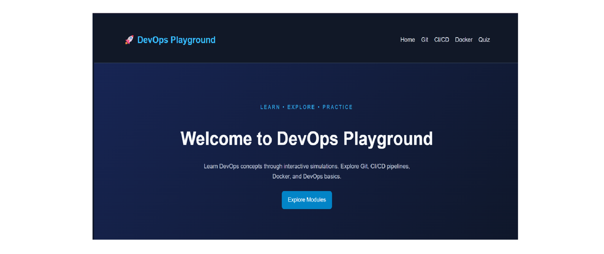
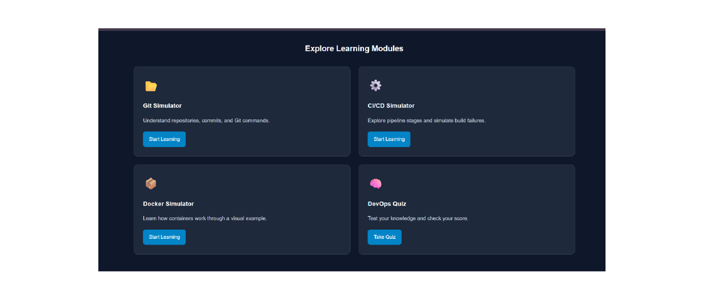
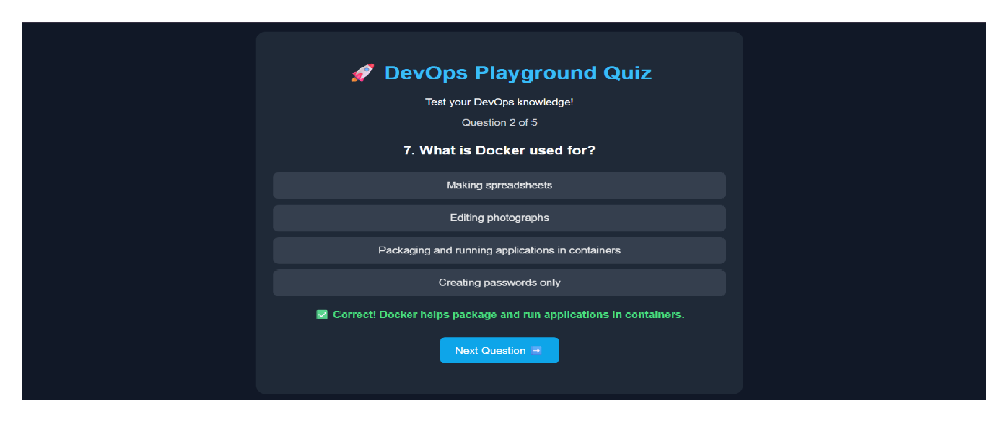
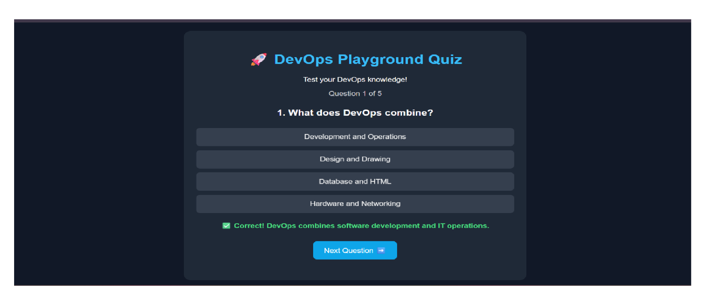
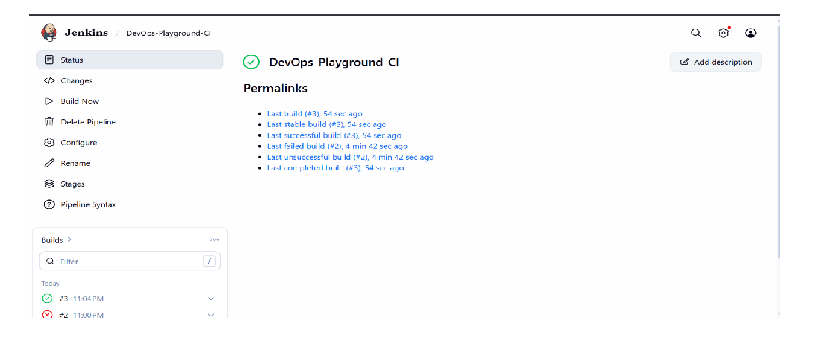
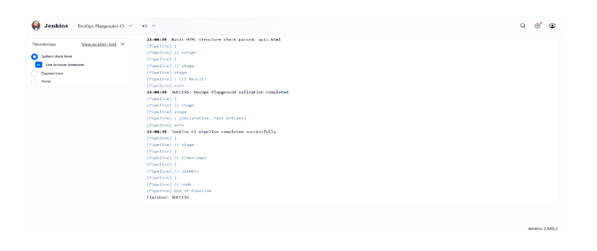
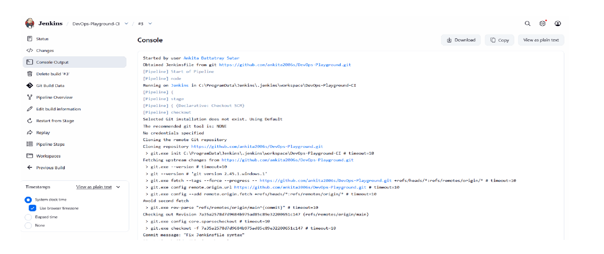
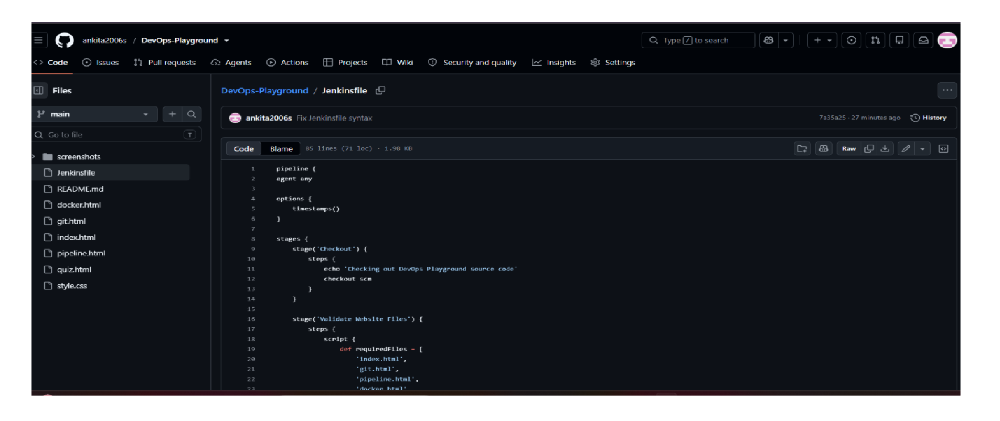
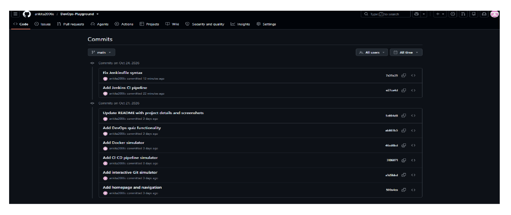

# 🚀 DevOps Playground — Learn Through Interactive Simulations

## 📌 Introduction

DevOps Playground is an interactive educational website designed to help students understand fundamental DevOps concepts through simple simulations.

The website provides interactive learning modules for Git commands, CI/CD pipelines, Docker concepts, and DevOps fundamentals through quizzes. The project also uses Jenkins to automate basic validation checks on the website files.

## 🎯 Objectives

* To understand fundamental DevOps concepts.
* To learn Git and GitHub version control.
* To understand the stages of a CI/CD pipeline.
* To explore Docker container operations.
* To test DevOps knowledge through interactive quizzes.
* To gain practical experience in website development.
* To understand basic CI pipeline automation using Jenkins.

## 🛠️ Technologies Used

| Technology | Purpose                                          |
| ---------- | ------------------------------------------------ |
| HTML5      | Structures the website pages.                    |
| CSS3       | Styles the website and its layout.               |
| JavaScript | Provides interactive website functionality.      |
| Git        | Tracks project changes using version control.    |
| GitHub     | Hosts the project repository and commit history. |
| Jenkins    | Automates basic project validation checks.       |
| Groovy     | Used to write the Jenkins pipeline script.       |

## ✨ Features

### 1. Home Page

Introduces DevOps Playground and provides navigation to the learning modules.

### 2. Git Simulator

Demonstrates basic Git commands through an interactive terminal-style simulation.

### 3. CI/CD Pipeline Simulator

Explains the basic stages of a CI/CD pipeline, including Code, Build, Test, and Deploy.

### 4. Docker Simulator

Provides an educational simulation to help users understand basic Docker container operations.

### 5. DevOps Quiz

Allows users to test their knowledge of DevOps concepts through interactive questions.

### 6. Jenkins CI Pipeline

Uses Jenkins and a `Jenkinsfile` to automate basic checks for required website files and HTML structure.

---

## 📸 Website Screenshots

### 1. Home Page



### 2. Home Page — Alternative View



### 3. Git Simulator


### 4. CI/CD Pipeline Simulator


### 5. CI/CD Pipeline — Alternative View


### 6. Docker Simulator


### 7. DevOps Quiz — Question View



### 8. DevOps Quiz — Alternative View



---

## ⚙️ Jenkins Continuous Integration (CI)

Jenkins is used to automate basic validation checks for the DevOps Playground project.

The pipeline is defined in the `Jenkinsfile`, which is stored in the root directory of the project repository.

### Jenkins Pipeline Stages

1. **Checkout:** Retrieves the project source code from GitHub.
2. **Validate Website Files:** Checks whether the required website files exist.
3. **Validate HTML Structure:** Checks for basic opening and closing HTML tags.
4. **CI Result:** Reports the pipeline result.

### Jenkins Configuration

* **Job Name:** `DevOps-Playground-CI`
* **Repository:** `https://github.com/ankita2006s/DevOps-Playground.git`
* **Branch:** `main`
* **Pipeline Script:** `Jenkinsfile`

### Jenkins Screenshots

#### 1. Jenkins Dashboard



#### 2. Jenkins Build Success



#### 3. Jenkins Console Output



#### 4. Jenkinsfile on GitHub



> **Note:** The pipeline performs basic file-existence and HTML-structure checks. It does not perform a complete HTML validation or deploy the website. A successful build should be reported only when confirmed in Jenkins.

---

## 🔄 Git and GitHub Workflow

Git is used to track changes to the project, while GitHub hosts the repository and its commit history.

The following commands were used during project development.

### Check Git Status

```bash
git status
```

### Add Project Files

```bash
git add .
```

### Commit Changes

```bash
git commit -m "Describe your changes"
```

### Push Changes to GitHub

```bash
git push origin main
```

### View Commit History

```bash
git log --oneline
```

### GitHub Repository

[Open the DevOps Playground Repository](https://github.com/ankita2006s/DevOps-Playground)

### GitHub Commit History Screenshot

The following screenshot provides evidence of the project's GitHub commit history.



### View Commits Online

[View All Commits on GitHub](https://github.com/ankita2006s/DevOps-Playground/commits/main/)

---

## 📝 Project Changes and Commit History

The project was developed incrementally using Git.

| No. | Commit Message                                    | Description                                        |
| --- | ------------------------------------------------- | -------------------------------------------------- |
| 1   | Add homepage and navigation                       | Created the homepage and website navigation.       |
| 2   | Add interactive Git simulator                     | Added the Git simulation page.                     |
| 3   | Add CI CD pipeline simulator                      | Added the CI/CD pipeline simulation.               |
| 4   | Add Docker simulator                              | Added the Docker simulation page.                  |
| 5   | Add DevOps quiz functionality                     | Added the DevOps quiz functionality.               |
| 6   | Update README with Jenkins and GitHub screenshots | Updated the project documentation and screenshots. |
| 7   | Add JavaScript functionality                      | Added the `script.js` file.                        |

**Note:** Verify the actual commit messages in GitHub before submitting. The table should reflect your real Git history.

---

## 💻 How to Run the Project

### Prerequisites

* A web browser.
* Visual Studio Code or another code editor.
* Git installed on your computer.

### Steps

**Step 1: Clone the repository**

```bash
git clone https://github.com/ankita2006s/DevOps-Playground.git
```

**Step 2: Open the project folder**

```bash
cd DevOps-Playground
```

**Step 3: Open the folder in Visual Studio Code**

Open the project folder using Visual Studio Code.

**Step 4: Run the website**

Open `index.html` in your browser.

Alternatively, install the Live Server extension in Visual Studio Code, right-click `index.html`, and select **Open with Live Server**.

---

## 📚 Learning Outcomes

* Learned how to structure web pages using HTML5.
* Practiced styling websites using CSS3.
* Explored JavaScript for interactive functionality.
* Learned version control using Git.
* Practiced managing a repository on GitHub.
* Understood the basic stages of a CI/CD pipeline.
* Explored Docker concepts through simulations.
* Learned how to configure a Jenkins pipeline using a `Jenkinsfile`.
* Practiced basic automated project validation using Jenkins.
* Learned how to document project development and integration evidence.

---

## 🏁 Conclusion

DevOps Playground is an educational website that introduces fundamental DevOps concepts through interactive simulations.

The project combines web development, Git, GitHub, Docker concepts, and Jenkins-based CI pipeline validation. It provides practical experience with version control and basic automation while helping students understand important DevOps principles.

---

## 🔗 Project Repository

**Project Name:** DevOps Playground — Learn Through Interactive Simulations

**GitHub Repository:**
https://github.com/ankita2006s/DevOps-Playground

**Technologies:** HTML5, CSS3, JavaScript, Git, GitHub, Jenkins, and Groovy.

**Project Type:** Educational website with interactive DevOps simulations and basic CI pipeline validation.
